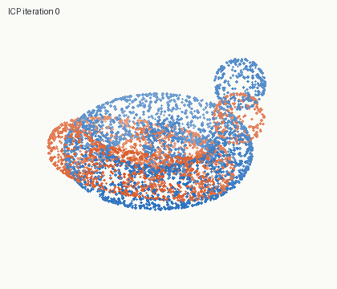
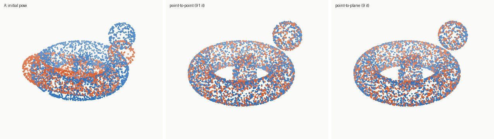
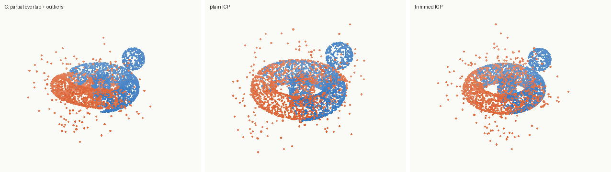
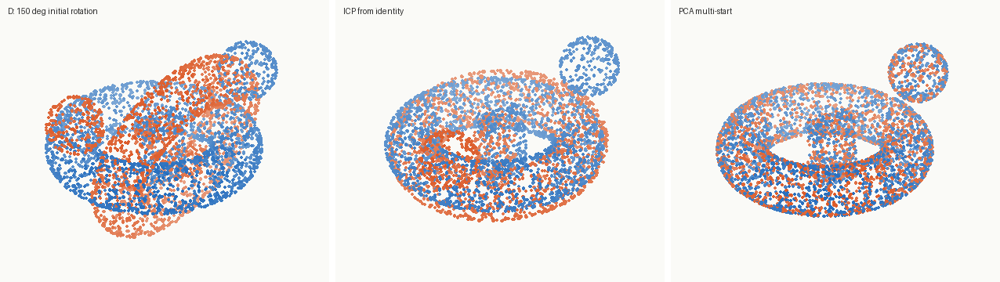
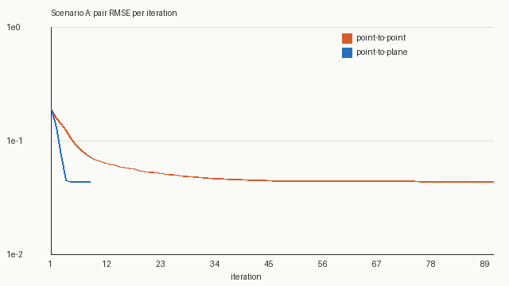
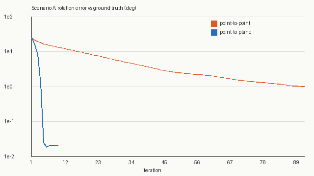

# cv-icp-registration

Rigid point-cloud registration from first principles: Iterative Closest Point
(point-to-point and point-to-plane), trimmed ICP for partial overlap and
outliers, and PCA-seeded multi-start for large initial rotations. Every result
is scored against a **known ground-truth pose**.

Only numpy and Pillow are needed. The point clouds are generated procedurally
(an asymmetric torus + sphere + box scene with analytic normals), so the repo
is self-contained and the tests are deterministic.



## What's inside

| File | Contents |
|---|---|
| `icpkit/se3.py` | Rodrigues exp/log on SO(3) (with near-0 and near-π branches); three closed-form absolute-orientation solvers: **Kabsch/SVD** with the `det = +1` fix, **Horn's quaternion** method, and **Umeyama** similarity with scale |
| `icpkit/clouds.py` | Area-uniform samplers for torus (by rejection on the area element `r(R + r cos v)`), sphere and box; noise, outliers, half-space crops; chunked exact nearest-neighbour and k-NN search; PCA normal estimation (Hoppe 1992) |
| `icpkit/icp.py` | ICP loop with point-to-point (Besl & McKay 1992) and point-to-plane (Chen & Medioni 1991, linearised as in Low 2004, then mapped back onto SO(3) with the exponential map so the pose stays exactly rigid); trimmed pair selection (Chetverikov 2002); PCA-frame candidates (all 4 proper sign patterns) plus multi-start `register()` |
| `icpkit/render.py` | Pillow-only orthographic renderer, log-scale convergence charts, animated GIF |
| `demo.py` | Four scenarios against ground truth; writes the figures in `docs/` |
| `tests/` | 27 `unittest` tests |

## Run it

```bash
pip install -r requirements.txt
python3 demo.py                              # numbers + figures in docs/
python3 -m unittest discover -s tests -t .   # or: python3 -m pytest tests
```

## Sample output (pasted from an actual run)

```
Scenario A: clean surfaces, 25 deg + translation, full overlap
  point-to-point                     iters= 91  rot err=  1.0294 deg  trans err=0.00197  rmse=0.0439  kept=100%    1737 ms
  point-to-plane (analytic normals)  iters=  9  rot err=  0.0209 deg  trans err=0.00039  rmse=0.0439  kept=100%     189 ms

Scenario B: Gaussian noise sigma=0.01 on both scans, PCA-estimated normals
  point-to-point                     iters=141  rot err=  1.1422 deg  trans err=0.00324  rmse=0.0461  kept=100%    2807 ms
  point-to-plane (estimated normals) iters= 14  rot err=  0.1740 deg  trans err=0.00062  rmse=0.0462  kept=100%     269 ms

Scenario C: partial overlap (two half-space crops) + 15% outliers in src
  (fraction of src with a true counterpart in dst: 58%)
  plain point-to-plane               iters= 60  rot err= 57.5074 deg  trans err=0.14030  rmse=0.3442  kept=100%     601 ms
  trimmed point-to-plane (keep 55%)  iters= 12  rot err=  0.3103 deg  trans err=0.00158  rmse=0.0400  kept= 55%     121 ms

Scenario D: 150 deg initial rotation
  point-to-plane from identity       iters= 60  rot err=145.0741 deg  trans err=0.38352  rmse=0.1454  kept=100%    1207 ms
  PCA multi-start + point-to-plane   iters=  1  rot err=  0.0299 deg  trans err=0.00042  rmse=0.0432  kept=100%    1481 ms
```

(Scenario D's multi-start shows 1 refinement iteration because the five
15-iteration coarse runs already converged; its time includes them.)

### Reading the numbers

* **Point-to-point converges slowly *and* to a biased answer** when the two
  scans are independent samples of the surface (as real scans always are).
  Each source point is pulled toward a specific *sample* in the target rather
  than toward the surface, so sampling jitter becomes pose error (~1° here).
  The residual floor (`rmse ≈ 0.044`) is the sample spacing, not misalignment.
* **Point-to-plane** only penalises distance *along the normal*, letting points
  slide tangentially. It converges in ~10 iterations to ~0.02° on clean data,
  and stays at 0.17° with σ = 0.01 noise and normals estimated by PCA.
* **Partial overlap breaks plain ICP** (57° off): every non-overlapping point
  and outlier still gets a partner and drags the pose. Trimming to the closest
  55% of pairs recovers the pose to 0.3°.
* **ICP is local.** From a 150° start it settles in a wrong basin (145° off).
  Seeding from the 4 proper PCA-frame alignments and keeping the best by
  trimmed MSE fixes that.

### Figures





| | |
|---|---|
|  |  |

## How the tests get their expected values

Nothing is snapshotted from the code's own output.

* **Hand-computed:** Rodrigues for 90° about z, 120° about (1,1,1)/√3 (the
  axis cycle x→y→z), and a 4-point Kabsch case (rotate 90° about z, shift by
  (1,2,3)).
* **Independent method:** Kabsch/SVD and Horn's quaternion eigenvector agree to
  1e-9 on 20 noisy, weighted problems.
* **Optimality / invariants:** Kabsch is a strict local minimum under random
  perturbations; a mirrored input still yields det(R) = +1; every PCA seed is a
  proper rotation; Umeyama recovers scale 2.5 exactly.
* **Closed form:** the torus sampler puts 0.5 + r/(πR) of its samples on the
  outer half, as the area element predicts; box faces get samples in proportion
  to face area; PCA normals on a plane are exactly (0,0,1) and on a sphere are
  radial.
* **Theorem:** with full correspondences, point-to-point pair MSE never increases
  (Besl & McKay 1992, Thm. 1).
* **Ground truth:** a rigid copy is recovered to < 1e-6°; independent samples to
  < 0.1° (point-to-plane); noisy scans < 0.5°; trimmed partial overlap < 1°; a
  150° start via multi-start < 0.1°. A single plane (3 unconstrained DoF) gives
  a finite, regularised step that fixes the constrained offset exactly.

Mutation check: 6 deliberate bugs (no det fix, flipped point-to-plane
Jacobian, trimming disabled, wrong pose composition order, non-uniform torus
sampling, PCA seeds allowed to be reflections) were each caught by the suite.

## License

MIT
